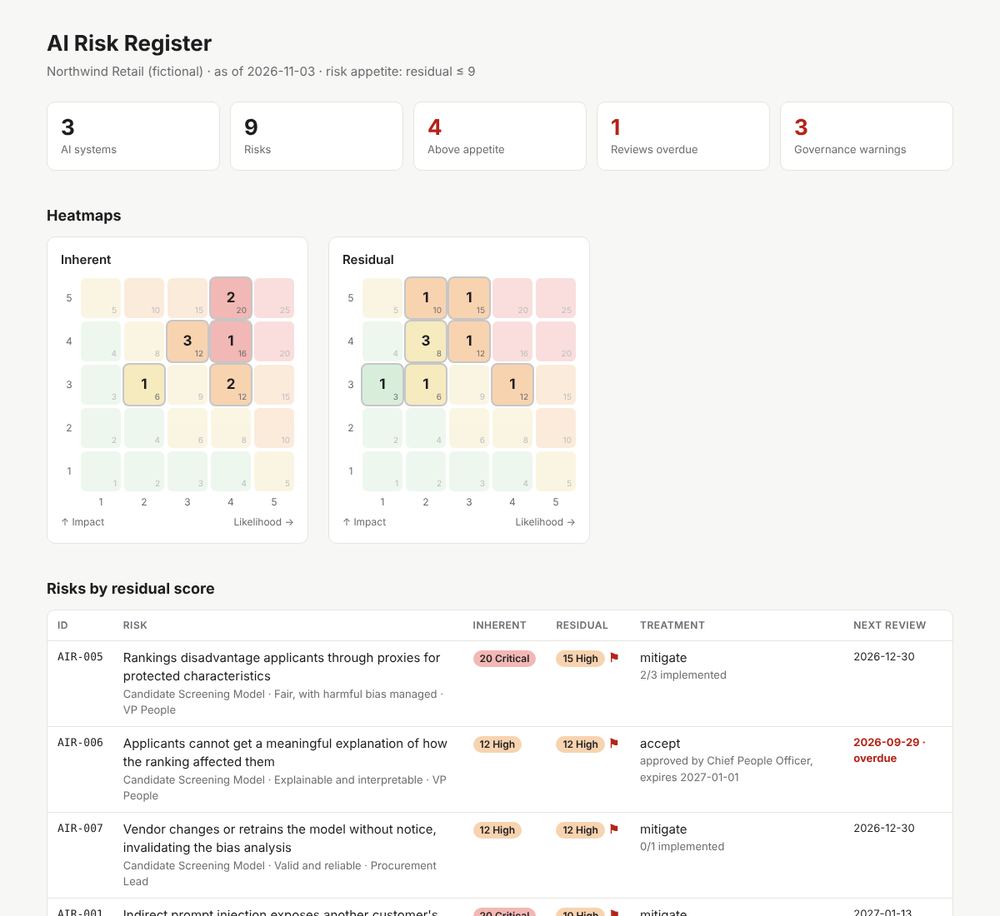

# AI Risk Register

An **AI risk register as code**. AI systems, risks and controls live in version-controlled YAML. A small Python CLI validates the register against governance rules, scores inherent and residual risk, maps controls to **NIST AI RMF 1.0** and **ISO/IEC 42001:2023**, and generates an HTML dashboard for risk committees.



## Why "as code"

Most AI risk registers are spreadsheets that drift: nobody notices the expired risk acceptance, the review that's four months late, or the residual rating that dropped without a control behind it. Keeping the register in Git gives you:

- **An audit trail.** Every rating change has an author, a timestamp and a reviewable diff.
- **Enforced rules.** `airisk validate --strict` in CI blocks a merge that breaks the methodology.
- **One source of truth.** The same files produce the committee dashboard, the CSV for the GRC tool, and the framework coverage evidence.

## What the validator enforces

| Rule | Level |
|---|---|
| Required fields, valid enums, likelihood and impact 1–5 | Error |
| Risk references a system that exists | Error |
| Residual likelihood or impact higher than inherent | Error |
| `mitigate` with no treatments listed | Error |
| Accepted risk above appetite without approver, date and expiry | Error |
| Risk acceptance past its expiry date | Error |
| Unknown NIST AI RMF or ISO/IEC 42001 reference | Error |
| System classified as an EU AI Act prohibited practice that isn't retired | Error |
| Residual score reduced but no treatment is implemented yet | Warning |
| Review overdue for the risk's residual rating (30/90/180/365 days) | Warning |
| Planned treatment past its due date | Warning |
| High-risk system with no documented human oversight | Warning |
| Production system with no assessed risks | Warning |

The scoring, appetite, acceptance and review rules are explained in [docs/methodology.md](docs/methodology.md).

## Quick start

```bash
git clone https://github.com/MattSandus22/AI-Risk-Register.git
cd AI-Risk-Register
python3 -m venv .venv && source .venv/bin/activate
pip install -e ".[dev]"

airisk validate examples/northwind --as-of 2026-11-03
airisk report   examples/northwind --as-of 2026-11-03 -o report.html
airisk coverage examples/northwind --as-of 2026-11-03
```

Open `report.html` in a browser. The sample register is a fictional retailer with three AI systems: a customer support assistant, a candidate screening model and a code assistant. It includes nine risks, a formal risk acceptance, and three deliberate governance findings for the validator to catch.

`--as-of` pins the evaluation date so the sample's findings stay stable. Leave it off for a real register.

## Commands

| Command | Purpose |
|---|---|
| `airisk validate DIR [--strict]` | Check data quality and governance rules. `--strict` fails on warnings too. |
| `airisk report DIR --format html\|md\|csv [-o FILE]` | Dashboard, Markdown summary, or flat CSV for import into a GRC tool. |
| `airisk coverage DIR` | NIST AI RMF categories and ISO/IEC 42001 objectives: covered, planned only, or gap. |

## Register format

```
my-register/
  config.yaml       # risk appetite, rating bands, review cadence (optional)
  systems.yaml      # AI system inventory
  risks.yaml        # risks, ratings, treatments, acceptances
  governance.yaml   # organization-wide controls (optional)
```

A risk looks like this:

```yaml
- id: AIR-001
  system: SYS-001
  title: Indirect prompt injection exposes another customer's order data
  category: secure_resilient          # NIST AI RMF trustworthy characteristic
  owner: Head of Application Security
  likelihood: 4
  impact: 5
  residual_likelihood: 2              # credited only for implemented treatments
  residual_impact: 5
  treatment: mitigate                 # mitigate | accept | transfer | avoid
  treatments:
    - description: Retrieval scoped to the authenticated customer at the API layer
      status: implemented             # planned | in_progress | implemented
      nist_ai_rmf: [MANAGE 1, MEASURE 2.7]
      iso_42001: [A.6, A.7]
  last_reviewed: 2026-10-15
```

Start a new register by copying `examples/northwind/` and replacing its contents.

## Using it in CI

```yaml
- run: pip install git+https://github.com/MattSandus22/AI-Risk-Register.git
- run: airisk validate risk-register/ --strict
- run: airisk report risk-register/ -o dashboard.html
```

With `--strict`, a pull request that lets a review lapse, accepts a risk without approval, or claims a residual reduction without an implemented control fails the build.

## Project layout

```
src/airisk/
  data/           NIST AI RMF categories, ISO/IEC 42001 Annex A objectives
  frameworks.py   catalogs and reference parsing (subcategories roll up)
  models.py       config, systems, risks, controls; scoring and review dates
  validate.py     governance rules
  coverage.py     framework coverage
  report.py       HTML dashboard, Markdown, CSV
  cli.py          airisk command
examples/northwind/   sample register and generated reports
docs/methodology.md   scoring, appetite, acceptance and review method
tests/                pytest suite
```

## Notes and limitations

- Framework titles are short paraphrases for display. Consult NIST AI 100-1 and the licensed ISO/IEC 42001 text for the requirements themselves.
- EU AI Act tiers record the organization's own classification, not a legal determination.
- Likelihood × impact is an ordinal scale for prioritization. The register records which controls are claimed; testing that they work is a separate assurance activity.

## Roadmap

- MIT AI Risk Repository and OWASP Top 10 for LLM Applications as optional risk taxonomies
- Per-system impact assessment template (ISO/IEC 42001 A.5)
- Trend view comparing register snapshots across Git history

## License

MIT. See [LICENSE](LICENSE).
